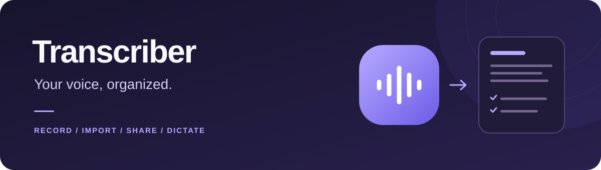

<p align="center">
  
</p>

<p align="center">
  Turn audio into searchable notes, clear summaries, and actionable to-dos.<br>
  Built for Android with Flutter. Powered by your own OpenAI or Google Gemini API keys.
</p>

<p align="center">
  <a href="#get-started">Android 8.0+</a> · arm64-v8a · <a href="LICENSE">MIT License</a>
</p>

<p align="center">
  <a href="https://github.com/boommasterxd/transcriber/releases/latest">Download APK</a> ·
  <a href="docs/provider-setup.md">Set up API keys</a> ·
  <a href="#development">Build from source</a> ·
  <a href="#documentation">Documentation</a>
</p>

## What you can do

| Workflow | Feature |
|---|---|
| **Capture your way** | Record with pause and resume, import an audio file, or send audio from another app through Android's share menu. |
| **Make it useful** | Keep the full transcript and optionally generate a title, short summary, key points, and checkable to-dos. |
| **Choose your models** | Select OpenAI or Gemini independently for transcription and summaries. Pick from the compatible models returned for your API key. |
| **Dictate into other apps** | Enable the optional Transcriber keyboard to stream speech into supported text fields. |
| **Find and reuse** | Search note titles, play retained audio, and copy or share note text. |
| **Feel at home** | German and English UI, system/light/dark themes, selectable accent colors, and layouts for phones and tablets. |

## Get started

1. Download the Android APK from the [latest release](https://github.com/boommasterxd/transcriber/releases/latest). The latest release also includes a `SHA256SUMS` file for checksum verification.
2. Install it on an **Android 8.0+ arm64-v8a** device. Android may ask you to allow installation from your browser or file manager.
3. Connect an OpenAI or Google Gemini API key during onboarding, choose a transcription model, and enable summaries if you want them.
4. Record, import, or share audio into Transcriber.

For live dictation, open **Settings > Transcriber keyboard** and follow the Android keyboard setup. Dictation uses the selected transcription provider and a separate compatible live model.

See [provider key setup](docs/provider-setup.md) for credential instructions and [audio formats and limits](docs/configuration.md#audio-formats-and-limits) for import and upload boundaries. [Configuration](docs/configuration.md) also explains model selection. This README describes the current source; published releases may differ.

## Your data and API usage

**Processing requires an internet connection and your own API access.** Audio goes to the selected transcription provider. When summaries are enabled, transcript text goes to the separately selected summary provider. Live dictation streams microphone audio to its provider.

Notes and settings are stored locally in SQLite through Drift. API keys use Android-backed `FlutterSecureStorage`. The note database is **not encrypted by the app**. Audio retention is configurable, and external original files are never deleted by Transcriber.

Provider billing, quotas, and data handling follow your provider account and terms. See [provider setup](docs/provider-setup.md), [security and privacy](docs/security.md), and [audio lifecycle](docs/cache-lifecycle.md) for details. Review AI-generated transcripts and summaries before relying on them.

## Development

Use the exact Flutter SDK in [`.fvmrc`](.fvmrc), **JDK 17**, and the Android SDK. The Android build configuration defines the required SDK and NDK versions; install those components before building. Device builds target arm64-v8a.

```bash
git clone https://github.com/boommasterxd/transcriber.git
cd transcriber
flutter pub get --enforce-lockfile
flutter run
```

With the pinned Flutter SDK on `PATH`, the core local checks are:

```bash
dart format --output=none --set-exit-if-changed lib test tool
flutter analyze --fatal-infos
flutter test --coverage --branch-coverage
dart run tool/quality/check_coverage.dart coverage/lcov.info
flutter build bundle --debug
```

These commands are a starting point. The [complete quality workflow](docs/code-quality.md) also covers complexity, unused code, duplication, native Kotlin, dependency auditing, and workflow checks. See [operations](docs/operations.md) for device tests and release verification.

The app uses **Riverpod** for state, **Drift/SQLite** for persistence, and dedicated service boundaries for recording, transcription, summaries, and live dictation. Start with the [architecture guide](docs/architecture.md) before changing those boundaries.

## Contributing

Bug reports and focused pull requests are welcome. For bugs, include the app version, Android version, device model, and steps to reproduce. Keep API keys, private audio, and transcript content out of reports.

Read [AGENTS.md](AGENTS.md) for repository conventions and [code quality](docs/code-quality.md) for required checks. Report vulnerabilities privately using [SECURITY.md](SECURITY.md).

## Documentation

| Guide | Covers |
|---|---|
| [Provider setup](docs/provider-setup.md) | Creating and connecting personal API keys. |
| [Configuration](docs/configuration.md) | Toolchain, model selection, formats, and resource limits. |
| [Architecture](docs/architecture.md) | Application layers, entry points, and processing flows. |
| [Audio lifecycle](docs/cache-lifecycle.md) | File ownership, retention, and temporary-file cleanup. |
| [Operations](docs/operations.md) | Local setup, device checks, troubleshooting, and releases. |
| [Security and privacy](docs/security.md) | Data transfers, credential protection, and known limitations. |
| [Code quality](docs/code-quality.md) | Required checks and coverage thresholds. |
| [CI test selection](docs/ci-test-selection.md) | How pull requests select checks and tests. |

The complete documentation index, including architecture decisions, is in [AGENTS.md](AGENTS.md#documentation-index).

## License

Original project source code and documentation are licensed under the [MIT License](LICENSE). Third-party components retain their respective licenses. OpenAI and Gemini names and logos remain subject to their owners' [brand terms](docs/configuration.md#provider-brand-assets).
